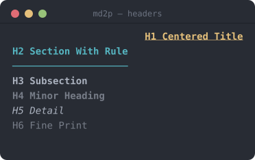
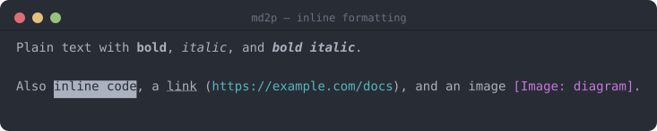
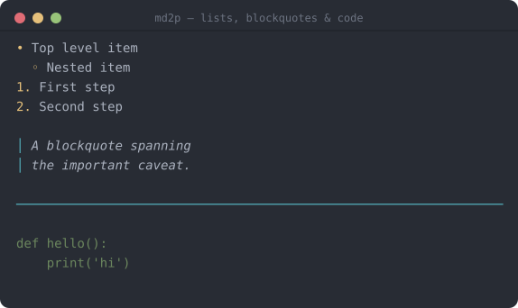
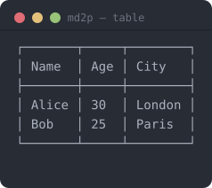

# md2p

[](https://github.com/raulkivi/md2p/actions/workflows/ci.yml)
[](https://scorecard.dev/viewer/?uri=github.com/raulkivi/md2p)
[](https://pypi.org/project/md2p/)

Last changed: 2026-11-19 · Source: <https://github.com/raulkivi/md2p>

`md2p` (Markdown to Print) renders Markdown in the terminal with ANSI styling, so you can read a Markdown file without leaving the shell.


## Quick start

```bash
uvx md2p README.md                    # run without installing
pip install md2p && md2p README.md    # or install it
```

## Features

- Renders a file or stdin to stdout with ANSI color, or with nroff overstrike sequences (`--nroff`)
- Supported Markdown:
  - ATX headers `#`–`######` (each level styled distinctly) and setext headers (`===`/`---`)
  - Horizontal rules, blockquotes, fenced code blocks (` ``` `/`~~~`)
  - Ordered and unordered lists, including nested lists
  - Tables, rendered as bordered ASCII grids
  - Bold, italic, bold+italic, inline code, links, images
- Shows hidden characters: non-printable bytes and Unicode variation selectors (used to hide watermarks or payloads in text) appear as visible hex markers
- Strips raw ANSI escapes from the input, so a malicious Markdown file can't send escape sequences to your terminal

## Installation

Requires Python 3.8+. There are no runtime dependencies.

### From PyPI

```bash
pip install md2p
```

Or run it without installing: `uvx md2p README.md`.

### From a Git clone

`install.sh` copies `md2p.py` to `~/.local/bin/md2p` (or `$XDG_BIN_HOME/md2p`):

```bash
git clone https://github.com/raulkivi/md2p.git
cd md2p
./install.sh                          # or: ./install.sh --dest "$HOME/bin"
```

`./install.sh --uninstall` removes it from the default location.

Make sure the install directory is on your `PATH`, for example in your shell profile:

```bash
export PATH="$HOME/.local/bin:$PATH"
```

## Usage

```bash
md2p path/to/file.md           # render a file
cat path/to/file.md | md2p     # render stdin
md2p path/to/file.md | less -R # page through a long file
```


- Output width follows the terminal width (H1 headers are centered, rules span the width).
- Output always contains ANSI escapes, even when redirected: `md2p file.md > out.txt` saves escape codes, not plain text.
- Exit status is 0 on success and 1 when the input is missing, unreadable, not UTF-8, or larger than 50 MB.

### Options

- `-h`, `--help` — show usage and exit.
- `-v`, `--version` — print the version and exit.
- `-n`, `--nroff` — emit nroff overstrike sequences (`X⌫X` for bold, `_⌫X` for
  underline) instead of ANSI escapes. Use this for viewers that understand
  nroff bold/underline but not ANSI color, such as Midnight Commander's
  internal viewer. Colors, dim and italic map onto bold or underline.

### Midnight Commander integration

To preview Markdown with formatting in `mc`'s internal viewer (F3), add a
viewer rule to your extension file. `~/.config/mc/mc.ext.ini` replaces the
system file rather than extending it, so start from a copy of the system file
(for example `/etc/mc/mc.ext.ini`):

```bash
mkdir -p ~/.config/mc
cp /etc/mc/mc.ext.ini ~/.config/mc/mc.ext.ini
```

Then replace its `[markdown]` section with:

```ini
[markdown]
Regex=\\.(md|mkd|mdown|markdown)$
RegexIgnoreCase=true
View=%view{nroff} md2p --nroff %f
```

- Keep the double backslash: mc unescapes the value, and with a single one the rule never matches.
- `%view{nroff}` makes the viewer interpret the overstrike sequences.
- For full ANSI color instead, use a color-capable pager: `View=md2p %f | less -R`.


## Examples

### Headers

Each header level gets distinct styling: H1 is centered, bold and underlined; H2 gets an underline rule; H3–H6 step down through bold, dim, italic and plain dim text.

```markdown
# H1 Centered Title
## H2 Section With Rule
### H3 Subsection
#### H4 Minor Heading
##### H5 Detail
###### H6 Fine Print
```



### Inline formatting

```markdown
Plain text with **bold**, *italic*, and ***bold italic***.

Also `inline code`, a [link](https://example.com/docs), and an image .
```



### Lists, blockquotes and code blocks

````markdown
- Top level item
  - Nested item
1. First step
2. Second step

> A blockquote spanning
> the important caveat.

---

```
def hello():
    print('hi')
```
````



### Tables

```markdown
| Name  | Age | City   |
|-------|-----|--------|
| Alice | 30  | London |
| Bob   | 25  | Paris  |
```



### Hidden and non-printable characters

Any character that is not printable (other than newline, tab and space) is replaced with a red hex marker: `<HH>` for a single byte, `<H0,H1,...>` for a multi-byte UTF-8 sequence. The surrounding text prints normally.

In this example `cat` shows a payment note for 95 EUR. `md2p` shows the variation selectors hidden after "Friday." and the carriage return that hid the real total:


Try it with a bell (`\a`) and a null byte (`\0`):

```bash
printf 'This line has a bell \a and a null \0 byte inside.\n' | md2p
```

Unicode variation selectors (`U+FE00`–`U+FE0F` and `U+E0100`–`U+E01EF`) get the same marker. They have zero visible width and are the most common way to attach hidden watermarks or payloads to ordinary-looking text, yet Python's `str.isprintable()` reports them as printable, so `md2p` checks for them explicitly.

Windows `CRLF` line endings are converted to `LF`. A lone carriage return, which could overwrite text already on screen, is shown as `<0D>`.

## Limitations

- These are passed through as plain text, not rendered:
  - strikethrough (`~~text~~`)
  - task-list checkboxes (`- [ ] item` shows `[ ]` after the bullet)
  - inline and block HTML
- Input larger than 50 MB is rejected.
- There is no built-in pager; pipe to `less -R`.

## Development

```bash
pip install -r requirements-dev.txt
pytest -q
```

### Recording the demo GIFs

The GIFs in `img/` are real takes in `xterm` on a private Xvfb display, recorded by:

```bash
python3 scripts/demo/record_demo.py [quick-start|hidden-characters|pager|midnight-commander ...]
```

- Requires Xvfb, `xterm`, `xdotool`, `ffmpeg`, `less`, `mc` and the DejaVu Sans Mono font.
- Each take runs with a throwaway `HOME`, so nothing from your shell setup appears in the frames.
- Review every frame before committing a GIF.

## Contributing

Bug reports and pull requests are welcome.

## License

MIT — see [LICENSE](https://github.com/raulkivi/md2p/blob/main/LICENSE).
